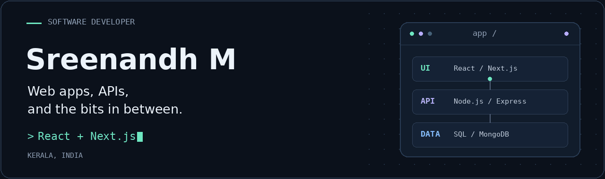

  <picture>
    <source media="(max-width: 600px) and (prefers-reduced-motion: reduce)" srcset="./assets/header-mobile-static.png">
    <source media="(prefers-reduced-motion: reduce)" srcset="./assets/header-static.png">
    <source media="(max-width: 600px)" srcset="./assets/header-mobile.gif">
    
  </picture>

  <a href="https://sreenandhm.vercel.app">Portfolio</a> &nbsp;·&nbsp;
  <a href="https://linkedin.com/in/sreenandh-m">LinkedIn</a> &nbsp;·&nbsp;
  <a href="mailto:sreenandhnandhu123@gmail.com">Email</a>

I'm Sreenandh, a software developer from Kerala, India. I build web applications with React, Next.js, Node.js and TypeScript. My work includes a CRM for an industrial motor business, employee-management APIs and websites with content-management tools.

I like working on both sides of an application: the interface people use and the APIs and databases behind it. I'm open to software development roles in India, remote work and opportunities abroad.

### What I'm working on

- **A billing app for a shop.** Web and Windows versions using SQLite. It's still in development; offline-first workflows and sync are the next pieces I'm working towards.
- **[FitPilotAI](https://github.com/sreenandh/FitPilotAI).** A fitness app I'm building with Gemini and Vapi for voice-based workout and meal planning, with Clerk for authentication and Convex for data.
- **Linux and DevOps.** Learning through KodeKloud's 100 Days of DevOps challenge.

I also use Claude Code and Codex in my development workflow.

### Selected work

#### Industrial Motor CRM

A quotation system for an industrial motor business, with a catalogue of 50+ motor specifications. I built the product autofill, custom PDF quotations, sequential numbering and permissions for Admin, HR and Staff. It supports EUR, USD and AED quotations.

**React · TypeScript · Node.js · Express · MySQL**

#### Employee Management System API

A backend with 40+ endpoints for attendance, tasks and leave management. I implemented JWT authentication, role-based access and OTP-based password recovery, then deployed it on a VPS using PM2 and GitHub Actions.

**Node.js · Express · MySQL · Prisma · GitHub Actions**

#### Harbourway Shipping

A logistics website with an admin panel for managing galleries and testimonials. I built the content-management features, contact form and email notifications.

**Next.js · React · Supabase · Nodemailer** &nbsp; [Website ↗](https://harbourwayshipping.com)

<strong>More projects</strong>

#### Param Yogi School of Yoga

A website with an admin dashboard and Supabase-backed content management. I worked on the content workflow, authentication and form protection.

**Next.js · React · Supabase · Tailwind CSS** &nbsp; [Website ↗](https://paramyogi.com)

#### NestFind

A property-listing application with JWT authentication, chat using Socket.IO, interactive maps and an admin dashboard.

**React · Node.js · MongoDB · Socket.IO · React Leaflet** &nbsp; [Repository ↗](https://github.com/sreenandh/NestFind-Real-Estate-Web-App)

#### Employee Document Manager

A document-management application with JWT authentication, file uploads to AWS S3, and an admin interface for organising and finding documents.

**React · Node.js · Express · MongoDB · AWS S3 · Multer** &nbsp; [Repository ↗](https://github.com/sreenandh/Employee-docs_manage)

### Tools I work with

| Area | Technologies |
| :--- | :--- |
| Languages | JavaScript, TypeScript, Python, SQL, C |
| Frontend | React, Next.js, HTML, CSS, Tailwind CSS, Redux, React Query |
| Backend | Node.js, Express, REST APIs, JWT, Socket.IO, Prisma |
| Data | MySQL, PostgreSQL, MongoDB, SQLite, Supabase |
| Development & deployment | Git, GitHub Actions, Linux, Postman, PM2, Vercel, Netlify |
| Project exposure | AWS S3/EC2, Docker, FastAPI, Angular, Gemini, Vapi, Convex |

### Experience

**Software Developer · Cybmirror Innovations, Kochi**  
September 2025 – March 2026  
Worked on full-stack applications, REST APIs, database operations, debugging and deployments.

**Software Engineer Intern · Nubolerta Technology Solutions, remote**  
May – June 2025  
Contributed to CloudBank using Angular, Node.js, Express and MySQL. Worked on application features and APIs with validation, error handling and JWT authentication.

### Education & training

**B.Tech, Computer Science and Engineering**  
Vimal Jyothi Engineering College · 2020–2024 · First Class

**MERN Stack Development Training**  
Luminar Technolab, Kochi · July 2024 – January 2025

<strong>Courses, certification and other learning</strong>

- MERN/MEAN Full Stack — NACTET
- Python Programming — IIT BombayX
- Responsive Web Design — freeCodeCamp
- Introduction to Generative AI, Large Language Models and Responsible AI — Google Cloud
- Deloitte Australia Technology job simulation — Forage
- Presented a paper at NCIPETC-24

---

Have a role or a project in mind? [Send me an email.](mailto:sreenandhnandhu123@gmail.com)
